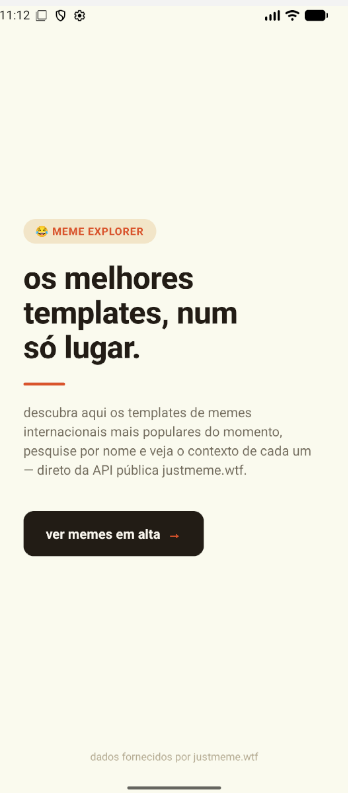
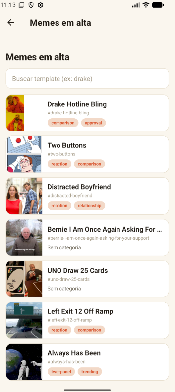
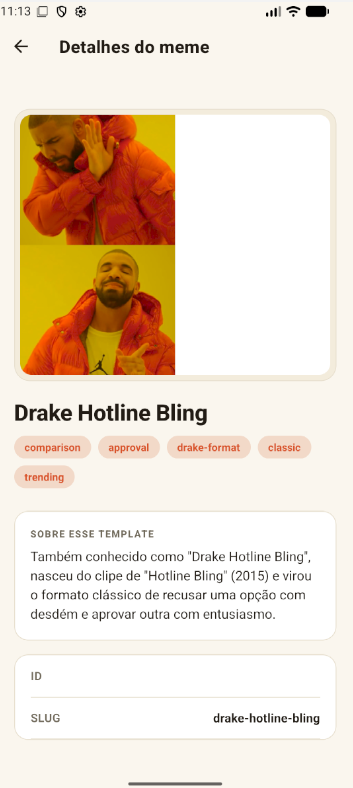
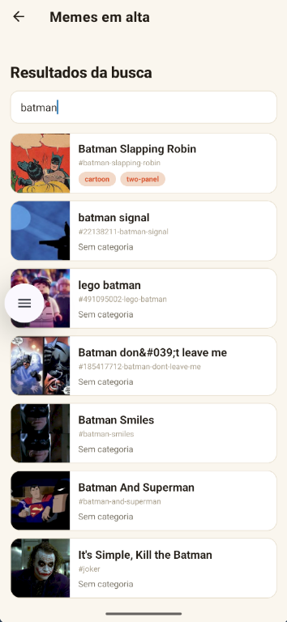

# meme explorer 

aplicativo mobile em react native com expo para explorar e pesquisar templates de memes em alta utilizando a api pública do `justmeme.wtf`.

---

## 📌 sobre o projeto

esta aplicação foi desenvolvida como parte da atividade prática individual de desenvolvimento para dispositivos móveis. o objetivo principal é consumir serviços web através de requisições assíncronas (fetch api), tratando estados de carregamento, erros e apresentando os dados com uma interface limpa, moderna e fluida.

---

## 🎯 requisitos atendidos

- **tela inicial (home):** título, descrição amigável sobre o app e botão de navegação.
- **tela de listagem (list):** consumo da api em tempo real, busca por texto, exibição de imagens, títulos, ids e categorias.
- **tela de detalhes (details):** informações completas sobre o template selecionado, dimensões da imagem, contexto histórico/origem do meme e tags.
- **navegação funcional:** integração total utilizando `@react-navigation/native-stack`.
- **tratamento de erros e loading:** telas preparadas para oscilações de rede ou falhas no consumo da api.

---

## 🛠️ tecnologias utilizadas

- [react native](https://reactnative.dev/)
- [expo](https://expo.dev/)
- [react navigation](https://reactnavigation.org/)
- [justmeme api](https://justmeme.wtf/)

---

## 🚀 como rodar o projeto localmente

### pré-requisitos
- node.js instalado
- aplicativo **expo go** no emulador android studio

## 📸 prints das telas funcionando

| tela Home | tela Lista | tela Detalhes | tela de resultados da busca |
| :---: | :---: | :---: | :---: |
|  |  |  |  |

